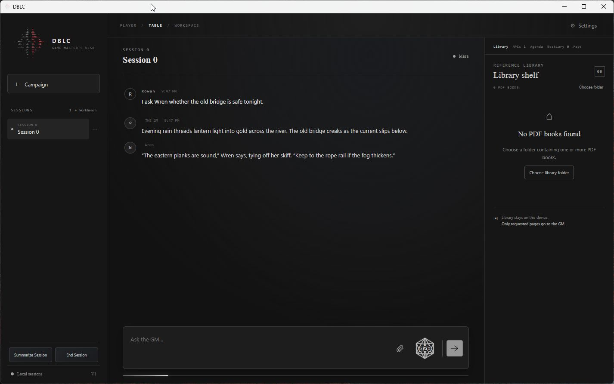
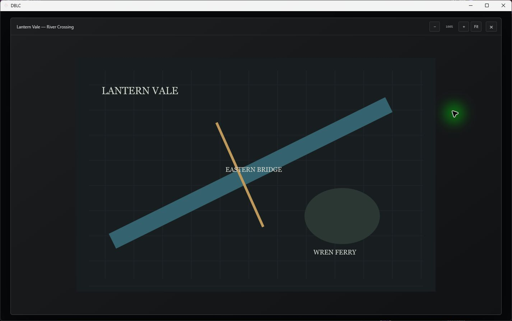

# DBLC

DBLC is a Windows tabletop role-playing workspace where a local AI model acts as Game Master. The Chronicle is the table: play is recorded there, while campaign records and reference tools are available alongside it. DBLC is designed for one human owner; an optional mobile browser view can connect to the same desktop instance.

## Screenshots

These screenshots use a fictional demonstration campaign and an original generated map.





## What DBLC includes

- **Chronicle:** streamed GM narration, Markdown, player dice rolls, NPC speaker identities and optional presentation effects.
- **Campaign workspace:** multiple campaigns and Sessions, disposable Workbenches with Review & End, summaries, campaign time and calendars, Agenda, Open Threads and the optional Surprise Machine.
- **GM records and tools:** Player Sheet proposals with approval, GM Notes, NPC and Bestiary records, campaign search, and tools for reading or updating supported records. The GM can search and read campaign history and records without automatically loading everything into context.
- **Rules and references:** user-selected local PDFs and optional Book Companion JSON provide searchable catalogues and on-demand passages. DBLC does not bundle rulebooks or companions; import only material you have permission to use. The GM should read the relevant source before presenting a rules-based answer.
- **Imported maps:** import PNG, JPEG or WebP images into a campaign, then view, zoom and pan them. A vision-capable model can inspect an opened map when the local server supports image input. Maps are loaded on demand.
- **Six starter Skills:** `rules-research`, `rules-adjudication`, `combat`, `advancement`, `campaign-memory` and `npc-portrayal`. They are optional local `SKILL.md` instructions: the GM can discover and load one when useful. See the [Skills guide](docs/skills/README.md) to add or edit skills.
- **Optional mobile interface:** DBLC can host a responsive browser view for the same campaign. Remote access is disabled by default and must be deliberately configured.

DBLC supplies tabletop tools, not a rules engine. The selected model and its chat template determine how reliably it follows instructions and calls tools. Some features, including image inspection, require model/server support.

## Requirements

- Windows 10 or 11.
- .NET 9 SDK to run from source.
- Microsoft Edge WebView2 Runtime for the desktop interface.
- A separately installed local model server with an OpenAI-compatible chat-completions API. DBLC's default endpoint is `http://127.0.0.1:8081/v1`; change it in Settings if your server uses another address.
- A model and server chat template that support tool calls for GM tools. Image inspection also requires a vision-capable model and server configuration.

## Run on Windows

1. Install the requirements above.
2. Start your local model server and note its API endpoint. Keep it bound to your own machine unless you intentionally configure secure network access.
3. Download or clone this repository, then open `DBLC.sln` in Visual Studio or run these commands from the repository folder:

   ```powershell
   dotnet restore DBLC.sln
   dotnet run --project src/DBLC/DBLC.csproj
   ```

4. In DBLC Settings, enter the server endpoint and choose your local Library folder if you have reference PDFs. Select a discovered model and start a Session.

To build a self-contained Windows x64 folder from source:

```powershell
$freshBuild = Join-Path (Get-Location) 'outputs/FreshBuild'
if (Test-Path -LiteralPath $freshBuild) { Remove-Item -LiteralPath $freshBuild -Recurse -Force }
dotnet publish src/DBLC/DBLC.csproj -c Release -r win-x64 --self-contained true -o $freshBuild
```

Run `outputs/FreshBuild/DBLC.exe`. WebView2 is still required. This is a development publish folder, not an installer or signed package.

## Local data and privacy

Settings and campaign data are stored under `%LOCALAPPDATA%\DBLC` by default. The selected Library remains in its chosen folder. DBLC does not ship your campaigns, saves, PDFs, Book Companions or model weights. Runtime files are excluded from source control; keep your own backups of campaign data.

For a separate test profile, set `DBLC_DATA_ROOT` to a disposable folder before launching DBLC. The optional mobile host is off by default and is not a public hosting service. Do not expose it directly to the public internet.

## Guides and notices

- [Agent Skills](docs/skills/README.md)
- [Book Companion processing specification](docs/DBLC_BOOK_PROCESSING_SPEC.md)
- [Mobile browser access](docs/MOBILE_TAILSCALE_STAGE1.md)
- [Surprise Machine guide](docs/SURPRISE_MACHINE_README.md)
- [Third-party notices](THIRD-PARTY-NOTICES.md)
- [MIT License](LICENSE)

## Previously explored features

### GM Sketch Maps — developed, later removed

DBLC previously included a GM-driven sketch-map system capable of creating and modifying maps during gameplay.

The feature was functional and ambitious, but introduced additional tool complexity and operational demands that were poorly suited to smaller local language models.

It was removed to prioritize reliable GM behavior, simpler tool use and faster gameplay—not because the concept lacked merit.

Imported image maps remain supported.

**Design philosophy:** DBLC prioritizes features that local models can use reliably over features that merely demonstrate technical capability.

## Limitations

DBLC is a source-built Windows application; it currently has no signed installer. Model behavior and tool reliability vary by model, chat template and server version. DBLC is MIT-licensed; third-party components retain their own terms. See `LICENSE` and `THIRD-PARTY-NOTICES.md`.
